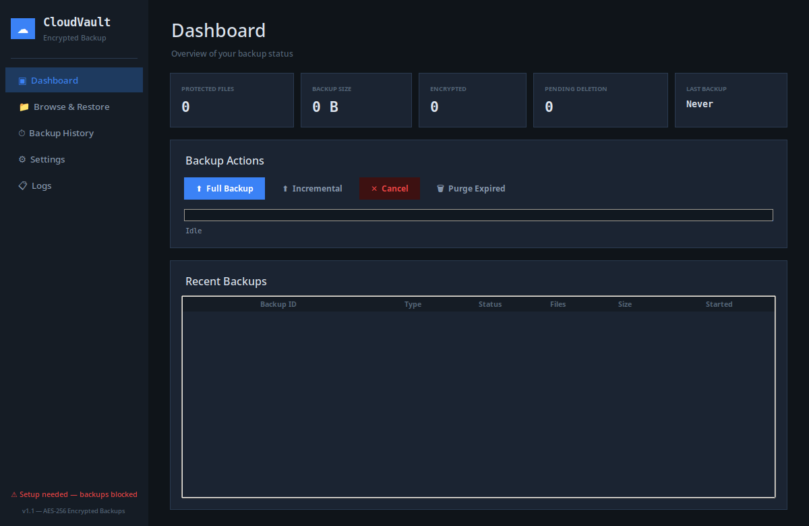
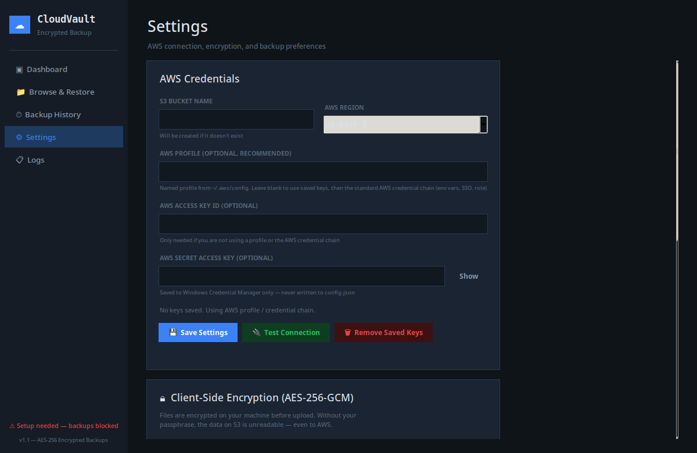

# CloudVault — Encrypted Windows Home Backup to AWS S3


**Topics:** `backup` · `aws-s3` · `windows` · `encryption` · `aes-256-gcm` · `client-side-encryption` · `python` · `tkinter` · `boto3` · `incremental-backup` · `zero-knowledge`



A native Windows desktop application for backing up your home folder to Amazon S3
with **AES-256-GCM client-side encryption**, full and incremental backups, a built-in
file browser with version history, one-click restore, and automatic 90-day retention.

---

<details>
<summary>Settings screen</summary>



*Screenshots show a fresh install with no data or credentials, captured on Linux — fonts differ slightly from Windows.*
</details>

## What It Does

CloudVault walks a folder on your PC (your Windows home folder by default),
uploads each file to an S3 bucket, and keeps a local SQLite catalog of every
file version it has uploaded. From the GUI you can browse that catalog like a
file explorer and download any version back to its original location or to a
folder of your choice.

### How a backup run works

1. **Scan** — recursively walks the home folder. Hidden folders (names starting
   with `.`) are skipped, **except `.ssh`, which is included** (safe because every upload is encrypted). Anything matching
   an exclude pattern is skipped.
2. **Hash** — computes a SHA-256 of each file. For an **incremental** backup, a
   file is skipped if its hash matches the most recent catalogued version.
   A **full** backup uploads every file regardless.
3. **Encrypt (always)** — every file is encrypted to a temp file first, and only the
   ciphertext is uploaded. If encryption isn't set up and unlocked, the run is refused.
4. **Upload** — each file goes to
   `s3://<bucket>/<prefix>/<backup_id>/<relative/path>`, where `backup_id` is
   e.g. `incremental_20260522_143000`. Every run gets its own folder, so older
   versions are never overwritten.
5. **Catalog** — records path, S3 key, hash, size, mtime and encryption flag in
   `catalog.db`.
6. **Mark deletions** — any catalogued file no longer present on disk is flagged
   as deleted (with a timestamp). Its S3 objects are kept.

### Retention

Deleted files stay in S3 and remain restorable. Clicking **Purge Expired**
permanently removes from S3 (and the catalog) every version of files that were
deleted more than `retention_days` ago (default 90). Purging is manual — nothing
is removed automatically.

### Restore

Restoring downloads the newest version (or one picked in **Show Versions**),
decrypting it if it was encrypted. By default it is written back to its
original path under the home folder, **overwriting any existing file**.
**Restore to...** writes to a folder you choose instead.

---

## Quick Start

### 1. Install Python 3.10+
Download from https://python.org — check **"Add to PATH"** during install.

### 2. Install dependencies
```
pip install boto3 cryptography keyring
```
(`cryptography` is required for client-side encryption; `keyring` enables saving AWS keys
to Windows Credential Manager. Both are installed by `start.bat`.)

### 3. Launch
Double-click **`start.bat`** or run:
```
python cloudvault.py
```

### 4. Configure (Settings tab)
- Enter your **S3 bucket name** and **AWS region**
- Provide AWS credentials in one of these ways (checked in this order):
  1. **AWS profile** name from `~/.aws/config` (recommended; also covers SSO)
  2. **Access Key ID + Secret Access Key** typed into Settings — saved to
     **Windows Credential Manager**, never to disk in plaintext
  3. The standard **AWS credential chain** (environment variables, `~/.aws/credentials`, IAM role)
- Click **Save Settings** → **Test Connection** (creates the bucket if it doesn't exist)
- The IAM user needs `s3:ListBucket`, `s3:GetObject`, `s3:PutObject`,
  `s3:DeleteObject` on the bucket (plus `s3:CreateBucket` if you want the app to create it)
- Set up encryption (required before any backup) — see below

### 5. Back Up (Dashboard tab)
- **Full Backup** — uploads everything
- **Incremental Backup** — only changed files (uses SHA-256 hash comparison)

---

## Encryption

CloudVault uses **AES-256-GCM** with **PBKDF2-SHA256 key derivation** (600,000 iterations
per OWASP recommendations). Files are encrypted on your machine before upload — the data
on S3 is unreadable without your passphrase, even to AWS.

### How to enable

1. Go to **Settings** → **Client-Side Encryption** section
2. Enter a passphrase (minimum 8 characters) and confirm it
3. Click **Enable & Lock Encryption**
4. Every backup is encrypted before upload. There is no plaintext mode, and
   backups are blocked until encryption is set up and unlocked

### How it works

- Your passphrase + a random 32-byte salt → PBKDF2 → 256-bit AES key
- Each file is encrypted with a unique 12-byte nonce (AES-256-GCM)
- A verification token is stored so the app can confirm your passphrase without
  downloading any files
- The salt and verification token are stored in `~/.cloudvault/config.json`
- The passphrase itself is **never** stored
- **Fail-closed:** if encryption is enabled but locked (or `cryptography` is missing), the
  backup is refused *before anything is uploaded*. It never falls back to plaintext.

### Unlocking on app restart

Each time you launch CloudVault, encryption is locked. Enter your passphrase in
Settings and click **Unlock** before running a backup or restoring encrypted files.

### ⚠ Important

If you lose your passphrase, **encrypted backups are permanently irrecoverable**.
There is no recovery mechanism by design — this is true zero-knowledge encryption.

### Encryption is mandatory

Encryption cannot be turned off. Because the backup includes `~/.ssh`, plaintext
uploads are not offered. Backups made by older versions without encryption stay
restorable (an incremental run re-uploads any unchanged file whose newest copy is
plaintext, encrypted; the old plaintext objects stay in S3 until you delete them
yourself), and the file browser shows a 🔒 icon next to encrypted files. Setup can
only be run once — re-running it would orphan existing backups, so the app refuses
and asks you to Unlock instead.

---

## Features

| Feature | Description |
|---------|-------------|
| **Native GUI** | Dark-themed Windows desktop app — no browser needed |
| **AES-256-GCM Encryption** | Mandatory client-side encryption before upload |
| **Full Backup** | Uploads every file to S3 |
| **Incremental Backup** | SHA-256 hash comparison — only changed files |
| **Browse & Restore** | Visual file browser with folder navigation |
| **Version History** | All versions of every file, with per-version restore |
| **Restore to...** | Restore files/folders to a custom destination |
| **90-Day Retention** | Deleted files stay recoverable (configurable) |
| **Purge Expired** | One-click cleanup of files past retention |
| **Cancel Backup** | Stop a running backup mid-flight |
| **Exclude Patterns** | Skip temp files, caches, node_modules, .git, etc. |
| **Live Progress** | File count, bytes uploaded, current filename |
| **Activity Logs** | Full engine log in the Logs tab |
| **Credential Management** | AWS profile, credential chain, or keys saved to Windows Credential Manager |

---

## Data Storage

All local data lives in `~/.cloudvault/`:

| File | Contents |
|------|----------|
| `config.json` | Settings, encryption salt & verification token (no AWS keys) |
| `catalog.db` | SQLite tracking every file, hash, encryption status, deletion state |
| `cloudvault.log` | Activity log |

---

## Scheduling Automatic Backups

CloudVault is GUI-only — there is currently no command-line / headless mode,
so backups must be started from the Dashboard. Encrypted backups also require
the passphrase to be entered each session. Unattended scheduling would need a
small wrapper that calls `BackupEngine().run_backup("incremental")` directly
(unencrypted, or with `encryptor.unlock(...)` called first).

---

## Security Model

| Layer | Protection |
|-------|------------|
| **At rest on S3** | AES-256-GCM (client-side, when enabled) + S3's default SSE-S3 bucket encryption |
| **In transit** | HTTPS (TLS 1.2+) via boto3 |
| **Key derivation** | PBKDF2-HMAC-SHA256, 600K iterations, 32-byte random salt |
| **Nonce** | 12 bytes, cryptographically random, unique per file |
| **Local credentials** | AWS keys live in Windows Credential Manager (or come from your AWS profile / credential chain). `config.json` never contains them |
| **Encryption failure mode** | Fail-closed: encryption is mandatory, and a missing/locked key aborts the backup before any upload |

---

## Limitations

- Each file is read fully into memory to encrypt/decrypt, so very large files
  need correspondingly large RAM when encryption is on.
- File names in S3 keys are not encrypted — only file contents are.
- The catalog (`catalog.db`) lives only on the local machine. If it is lost,
  the S3 data is still there but the in-app browser will be empty.
- If you use a long-lived IAM access key, scope it to the backup bucket only. Prefer an
  AWS profile with SSO / short-lived credentials.
- Upgrading from an older version: plaintext keys found in `config.json` are moved to
  Credential Manager and removed from the file on first launch (if `keyring` is installed).
- Primarily built and tested for Windows (uses Segoe UI fonts and the Windows
  dark title bar); the Tkinter GUI may run elsewhere but isn't supported.

---

## Troubleshooting

| Issue | Fix |
|-------|-----|
| "Connection failed" | Check bucket name, region, and credentials |
| "cryptography not installed" | Run `pip install cryptography` |
| "Encryption locked" warning | Enter passphrase in Settings → Unlock |
| Wrong passphrase | The app will tell you — re-enter the correct one |
| PermissionError on files | Add them to exclude patterns |
| Slow first backup | Full backup of a large home folder takes time |

---

## License

Released under the [MIT License](LICENSE).
